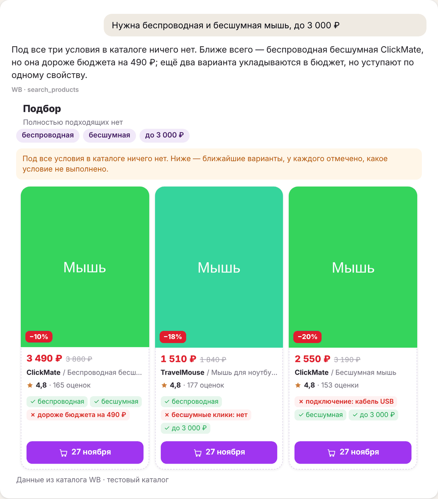
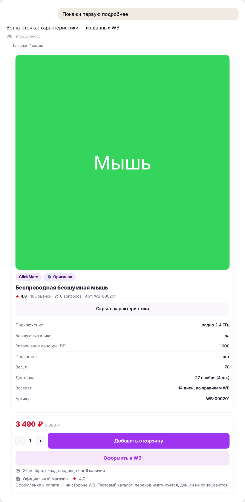
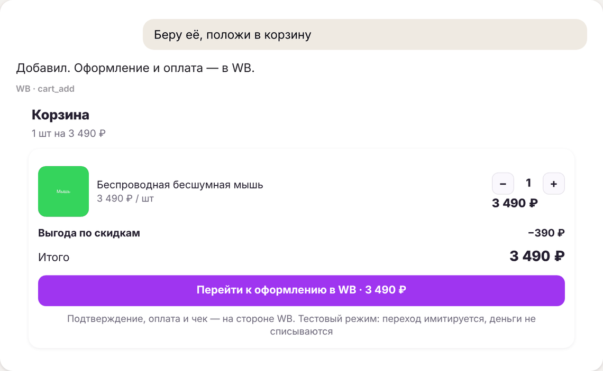
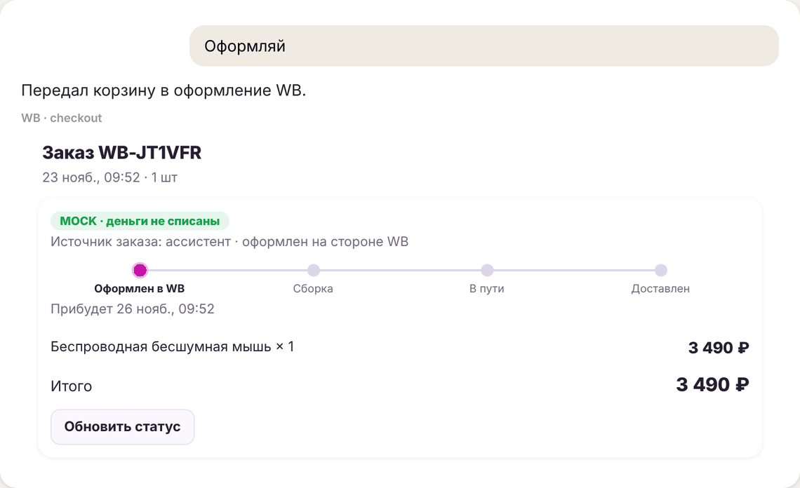

# wb-shop-mcp

Мок MCP-сервер магазина в стиле Wildberries для MVP команды «Тренды»
(Бизнес-студия, ЦУ): покупатель описывает запрос ассистенту в чате,
ассистент подбирает товары по условиям из каталога, собирает корзину и
передаёт её в оформление WB. React-вьюхи (MCP Apps) рисуют карточки прямо в чате.

**Граница MVP:** подборка и корзина — в чате; подтверждение заказа, оплата и
чек — на стороне WB. В прототипе переход в WB имитируется, деньги не списываются.

| Подбор по условиям | Карточка | Корзина → WB | Заказ |
|---|---|---|---|
|  |  |  |  |

## Запуск

```bash
bun install
bun run dev      # http://localhost:3000/mcp
bun run check    # сборка UI + tsc + тесты
```

Подключение к Claude: Settings → Connectors → Add custom connector →
`https://<деплой>/mcp` (без OAuth).

## Сценарий для интервью

Запрос «беспроводная бесшумная мышь до 3 000 ₽» — в каталоге нет товара под все
три условия. Ассистент честно говорит об этом и показывает 3 ближайших варианта:
у каждого отмечено, что выполнено (✓) и что нет (✗ «дороже бюджета на 490 ₽»,
✗ «подключение: кабель USB»). С бюджетом 4 000 ₽ находится точное совпадение.

Перед каждой беседой — сброс корзины, заказов и метрик:

```bash
curl -X POST https://<деплой>/reset -H "Authorization: Bearer $RESET_TOKEN"
```

Эндпоинт работает, только если на сервере задан `RESET_TOKEN` (иначе 404).

## Тулы

| Тул | Что делает |
|---|---|
| `search_products` | Подбор: `query` (тип товара) + условия `maxPrice`, `minPrice`, `wireless`, `silent`, `backlight`, `minDpi`, `maxDeliveryDays`. Возвращает точные совпадения или `exact: false` и ближайшие варианты с проверками ✓/✗/? по каждому условию. Свойства из текста запроса («беспроводная», «до 3 000») сервер выносит в условия сам. |
| `show_product` | Карточка: цена, скидка, рейтинг, срок доставки, наличие, характеристики. |
| `cart_add`, `cart_update`, `show_cart` | Корзина. |
| `checkout` | Передать корзину в оформление WB (имитация): тестовый заказ с меткой источника «ассистент». |
| `show_orders`, `show_order` | Заказы: Оформлен в WB → Сборка → В пути → Доставлен. |
| `show_stats` | Метрики прототипа: время от первого поиска до оформления, конверсии, поиски с 3+ условиями и без полного совпадения. |

Правила для ассистента (не выдумывать свойства, не больше 3 вариантов, честное
«подходящего нет», оплата — в WB) передаются в `instructions` сервера и в описаниях тулов.

## Данные

- `src/store/data.json` — 201 тестовый товар. У пилотной категории «периферия»
  (14 мышей, 14 клавиатур и «Беспроводная бесшумная мышь» #201) есть `specs`:
  подключение, бесшумность, DPI, подсветка, вес, переключатели, формат.
  У остальных товаров характеристик нет — фильтр отвечает «нет данных» (?), а не угадывает.
- Рейтинг, скидка, остаток и срок доставки детерминированы по id и считаются на
  сервере (`src/store/catalog.ts`): ассистент и карточка видят одни и те же значения.

## Структура (весь код в `src/`)

- `src/server.ts` — точка входа (`Bun.serve`): `/mcp`, `/health`, `/reset`, `/screens/*.png`.
- `src/mcp/server.ts` — фабрика `createMcpServer()` и `instructions` для ассистента.
- `src/mcp/resources.ts` — `ui://` ресурсы (HTML читается из `dist/ui/`).
- `src/mcp/schemas.ts` — общие zod-схемы `structuredContent`.
- `src/mcp/tools/` — по файлу на домен: `search.ts`, `cart.ts`, `orders.ts`, `stats.ts`.
- `src/store/` — каталог и поиск (`catalog.ts` + тесты), корзина, заказы, метрики, данные.
- `src/ui/views/*.tsx` — экраны (React + `useApp`), `src/ui/shared.tsx` — общее.
- `scripts/build-ui.ts` — сборка UI в `dist/ui/<view>.html` (вшита в `dev`/`start`/`build`).
- `docs/screens/` — скриншоты сценария (README, слайды).

## Ограничения прототипа

- Каталог тестовый: выдуманные товары, картинки-заглушки.
- Корзина, заказы и метрики — в памяти процесса: общие для всех чатов,
  сбрасываются при рестарте/редеплое.
- Метка источника заказа показывает маршрут, но не доказывает, что заказ новый —
  это меряет только A/B на трафике WB.
